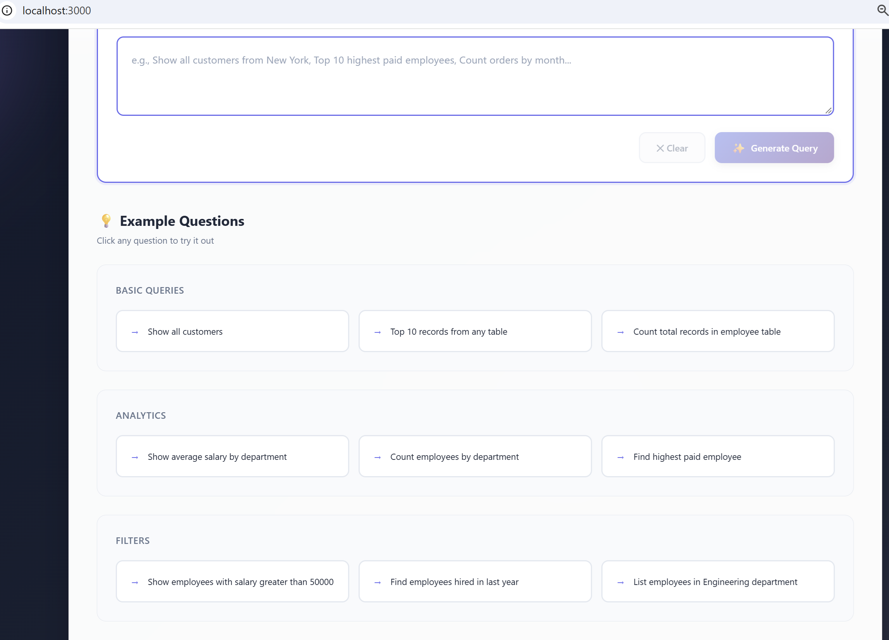

# 🤖 AI-Powered SQL Chatbot | Natural Language to SQL (NL2SQL)

An AI-powered, full-stack web application that converts natural language questions into SQL queries and executes them against a Microsoft SQL Server database.

Ask questions in plain English, generate SQL queries using AI, and view database results through an interactive React interface.



## 🚀 Project Overview

The SQL Chatbot simplifies database interaction by allowing users to query structured data using natural language instead of manually writing SQL statements.

**Example:**

User question:

> Show all customers from New York

AI-generated SQL:

```sql
SELECT *
FROM customers
WHERE city = 'New York';
```

The application validates the generated query, executes it against SQL Server, and displays the results in a structured table.

## ✨ Key Features

- **Natural Language to SQL:** Convert plain English questions into SQL queries.
- **AI Integration:** Supports OpenAI GPT-4 and Anthropic Claude integrations.
- **Microsoft SQL Server:** Connects to SQL Server using PyODBC.
- **Automatic Schema Detection:** Retrieves database tables, columns, and data types.
- **SQL Query Validation:** Checks generated queries and restricts non-SELECT operations.
- **Interactive Frontend:** React-based user interface.
- **REST API:** Django REST Framework for frontend-backend communication.
- **Results Visualization:** Displays generated SQL and query results in tabular format.
- **CSV Export:** Provides an option to export query results.

## 🏗️ System Architecture

The application follows a layered architecture.

| Layer | Technology | Responsibility |
|---|---|---|
| Presentation | React.js, CSS | User interface |
| API | Django REST Framework | HTTP requests and responses |
| Business Logic | Python | Request processing and orchestration |
| Database Layer | PyODBC | SQL Server connectivity |
| AI Layer | OpenAI / Anthropic | Natural language to SQL generation |
| Database | Microsoft SQL Server | Data storage and query execution |

### Application Workflow

1. User enters a natural language question.
2. React frontend sends a POST request using Axios.
3. Django receives the request through its REST API.
4. Database service retrieves the database schema.
5. AI service generates an SQL query using the schema and user question.
6. Generated SQL is validated.
7. PyODBC executes the query against SQL Server.
8. Django returns the results as JSON.
9. React displays the generated SQL and query results.

## 🛠️ Technology Stack

### Backend
- Python
- Django 5.0
- Django REST Framework 3.14
- PyODBC 5.0.1
- django-cors-headers 4.3.1
- python-dotenv 1.0.0

### Frontend
- React 18.2
- React DOM 18.2
- Axios 1.6
- JavaScript
- HTML5
- CSS3

### AI Services
- OpenAI GPT-4
- Anthropic Claude

### Database
- Microsoft SQL Server
- ODBC Driver 17 for SQL Server

## 📂 Project Structure

```text
sql_chatbot/
│
├── backend/
│   ├── manage.py
│   ├── nl2sql_project/
│   │   ├── settings.py
│   │   ├── urls.py
│   │   ├── wsgi.py
│   │   └── asgi.py
│   │
│   └── query_api/
│       ├── views.py
│       ├── urls.py
│       ├── database_service.py
│       ├── ai_service.py
│       ├── models.py
│       └── admin.py
│
├── frontend/
│   ├── public/
│   ├── src/
│   │   ├── App.js
│   │   ├── App.css
│   │   ├── index.js
│   │   └── index.css
│   ├── package.json
│   └── package-lock.json
│
├── SQLChat.png
├── requirements.txt
├── start_servers.py
├── start-dev.bat
├── .env.example
├── .gitignore
└── README.md
```

*Note: The structure above describes the documented architecture. Adjust folder names if your actual repository differs.*

## ⚙️ Installation and Setup

### Prerequisites

Make sure you have installed:

- Python 3.10+
- Node.js and npm
- Microsoft SQL Server
- Microsoft ODBC Driver 17 for SQL Server
- OpenAI or Anthropic API credentials

### 1. Clone the repository

```bash
git clone https://github.com/dsridharit03/sql_chatbot.git
cd sql_chatbot
```

### 2. Set up Python environment

```bash
python -m venv sqlvenv
```

Activate the environment on Windows:

```powershell
sqlvenv\Scripts\activate
```

### 3. Install backend dependencies

```bash
pip install -r requirements.txt
```

### 4. Install frontend dependencies

```bash
cd frontend
npm install
cd ..
```

### 5. Configure environment variables

Create a `.env` file based on `.env.example`.

Configure your database connection and AI provider credentials.

Example configuration (use your actual variable names as defined in your application):

```env
OPENAI_API_KEY=your_openai_api_key
ANTHROPIC_API_KEY=your_anthropic_api_key

DB_SERVER=localhost
DB_NAME=YourDatabase
DB_USER=your_username
DB_PASSWORD=your_password
```

**Important:** Never upload your actual `.env` file, API keys, database passwords, or other credentials to GitHub.

### 6. Start the application

Use the project startup script if configured:

```bash
python start_servers.py
```

Alternatively, start the Django backend and React frontend using their respective development commands.

Backend:

```bash
python manage.py runserver 8000
```

Frontend:

```bash
cd frontend
npm start
```

Frontend URL:

http://localhost:3000

Backend URL:

http://localhost:8000

## 🔌 API Endpoints

The documented backend exposes the following API operations:

| Method | Endpoint | Description |
|---|---|---|
| GET | `/api/health/` | API health check |
| GET | `/api/test-connection/` | Test database connection |
| GET | `/api/schema/` | Retrieve database schema |
| POST | `/api/query/` | Generate and execute SQL |
| POST | `/api/test-sql/` | Test SQL execution |

### Example API Request

```json
{
  "question": "Show all customers from New York"
}
```

### Example API Response

```json
{
  "success": true,
  "question": "Show all customers from New York",
  "sql": "SELECT * FROM customers WHERE city = 'New York'",
  "data": [
    {
      "id": 1,
      "name": "John",
      "city": "New York"
    }
  ],
  "rowCount": 1
}
```

## 🔐 Security Considerations

The application documentation describes the following security practices:

- SQL query validation to restrict non-SELECT operations.
- Environment variables for sensitive configuration.
- CORS configuration for frontend-backend communication.
- Django CSRF middleware.
- Input validation.
- Separation of database and AI service logic.

**Production recommendation:** SQL keyword checks alone are not sufficient to guarantee SQL injection protection. Use a read-only database account, enforce query timeouts and resource limits, and apply robust SQL parsing and execution controls before production deployment.

## 🧠 AI Integration

The application supports two AI provider integrations:

**OpenAI**
- Natural language understanding.
- SQL query generation.
- Schema-aware prompt engineering.

**Anthropic Claude**
- Natural language processing.
- SQL query generation.
- Alternative AI provider integration.

The AI service layer manages communication with the configured provider and processes generated SQL responses.

## 🎯 Project Objectives

- Simplify database querying through natural language.
- Reduce the need for manual SQL writing.
- Demonstrate practical integration of Generative AI with traditional databases.
- Build a full-stack application using Python and React.
- Demonstrate REST API development and database integration.

## 🔮 Future Enhancements

Potential improvements include:

- Conversation history and multi-turn database interactions.
- Support for additional database platforms.
- Advanced SQL validation and query optimization.
- Role-based access control.
- Query execution monitoring and logging.
- Docker-based deployment.
- Cloud deployment and scalability improvements.

## 👨‍💻 Author

**Sridhar Duraisamy**

Senior Software Engineer | Generative AI Engineer

GitHub: [@dsridharit03](https://github.com/dsridharit03)

---

⭐ If you find this project useful, feel free to explore the repository and share your feedback.

**Project:** AI-Powered Natural Language to SQL Chatbot  
**Backend:** Python / Django REST Framework  
**Frontend:** React.js  
**Database:** Microsoft SQL Server  
**AI:** OpenAI GPT-4 / Anthropic Claude
